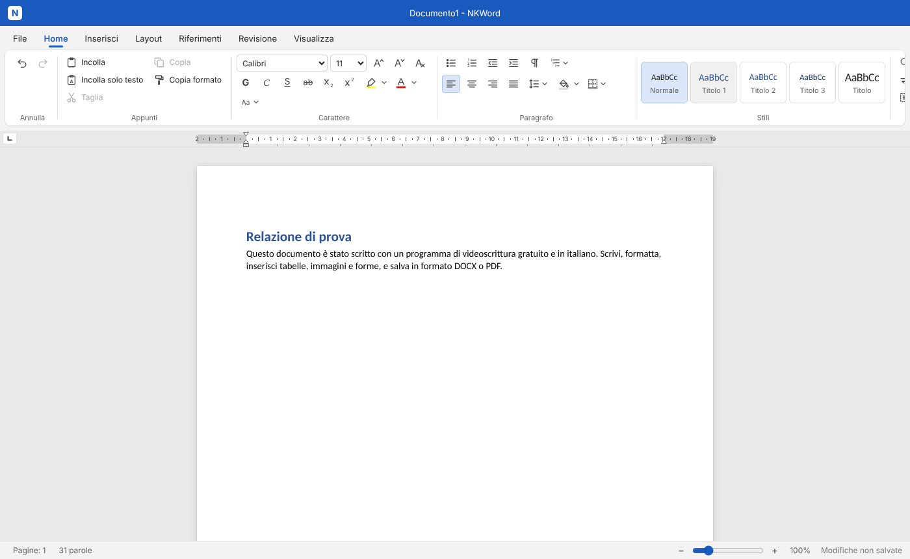

# NKWord

Programma di videoscrittura gratuito e in italiano, simile a Microsoft Word, scritto in TypeScript.
Funziona come programma da installare (Windows e Mac) oppure nel browser.



## Scarica il programma (senza Node.js)

Scarica dalla pagina [Release "ultima versione"](../../releases/latest):

- **Windows, installazione**: [`NKWord-installa.exe`](../../releases/latest/download/NKWord-installa.exe). Crea il collegamento sul desktop e nel menu Start; si disinstalla da *Impostazioni > App*.
- **Windows, senza installare**: [`NKWord-portable.exe`](../../releases/latest/download/NKWord-portable.exe). Doppio clic e parte, anche da chiavetta USB.
- **Mac**: [`NKWord-mac.dmg`](../../releases/latest/download/NKWord-mac.dmg). Aprilo e trascina NKWord in *Applicazioni*; la prima volta clic destro sull'app, *Apri*.

Il programma non è firmato digitalmente: Windows può mostrare l'avviso SmartScreen, clicca *Ulteriori informazioni* e poi *Esegui comunque*.
I file vengono ricostruiti in automatico (GitHub Action "Programma desktop") a ogni modifica su `main`; il codice del pacchetto è nella cartella `desktop/` (Electron + electron-builder).

## Cosa sa fare

Le funzioni sono organizzate nelle stesse schede di Word.

- **File**: nuovo, apri, salva e salva con nome in DOCX, HTML, testo e PDF; apertura di file DOCX, HTML, testo e PDF; documenti recenti; anteprima di stampa e stampa; salvataggio automatico con recupero dopo una chiusura improvvisa.
- **Home**: appunti (incolla, incolla solo testo, taglia, copia), copia formato, carattere (tipo, dimensione, grassetto, corsivo, sottolineato, barrato, pedice, apice, evidenziatore, colore, maiuscole/minuscole), paragrafo (allineamento, rientri, interlinea, bordi, sfondo), elenchi puntati, numerati e a più livelli, stili (Normale, Titolo 1-3, Titolo), trova e sostituisci, dettatura vocale.
- **Inserisci**: tabelle, immagini, forme, caselle di testo, grafici, collegamenti ipertestuali, simboli, intestazione, piè di pagina, numeri di pagina, interruzioni di pagina e di sezione.
- **Layout**: margini, orientamento, dimensioni della pagina, interruzioni, spaziatura dei paragrafi.
- **Riferimenti**: sommario, note a piè di pagina, didascalie, riferimenti incrociati, indice analitico.
- **Revisione**: controllo ortografico in italiano e inglese, correzione automatica mentre si scrive, commenti, revisioni (rileva modifiche, accetta, rifiuta), lettura ad alta voce, traduzione della selezione o del documento.
- **Visualizza**: modalità lettura, righello con rientri e tabulazioni, segni di formattazione, zoom, tema chiaro, scuro o automatico.

Le scorciatoie da tastiera principali sono le stesse di Word (Ctrl+B, Ctrl+I, Ctrl+S, Ctrl+K, Ctrl+P, Ctrl+Z...).

### Funzioni che usano Internet

Tutto il resto funziona senza connessione e i documenti restano sul computer.

- **Traduci** invia il testo da tradurre al servizio gratuito di Google Traduttore.
- **Detta**, nel browser Chrome o Edge, usa il riconoscimento vocale del browser (Google o Microsoft). Nel programma installato si apre invece la dettatura di Windows (Win+H) o del Mac.

## Avvio dal codice con un doppio clic

Serve [Node.js](https://nodejs.org) 22.12 o più recente (versione LTS). Scarica il progetto (pulsante verde *Code > Download ZIP*), estrai la cartella e poi:

- **Windows**: doppio clic su `avvia.bat`.
- **macOS**: doppio clic su `avvia.command`. La prima volta macOS può bloccarlo: clic destro sul file, *Apri*, poi *Apri* di nuovo.
- **Linux**: esegui `./avvia.sh`.

La prima volta scarica i pacchetti (qualche minuto), poi apre l'app nel browser. Per chiuderla basta chiudere la finestra nera del terminale.

## Sviluppo

```bash
npm install
npm run dev        # avvia l'app nel browser
npm run typecheck
npm test
```

Per provare il programma desktop: `cd desktop && npm install && npm start`.

## Struttura

Ogni funzione vive in un modulo separato in `src/`, con i suoi test nella cartella omonima di `tests/`.

| Cartella | Contenuto |
| --- | --- |
| `src/core` | Base comune: modello del documento, unità, stato, comandi, cronologia, contratti fra moduli. Si modifica solo coordinandosi. |
| `src/editing` | Comandi di modifica del testo, formattazione di carattere e paragrafo, stili, trova e sostituisci. |
| `src/structures` | Tabelle, elenchi puntati/numerati, immagini, interruzioni, sezioni e impostazioni di pagina. |
| `src/layout` | Impaginazione e rendering delle pagine. |
| `src/io` | Formati di file (DOCX, HTML, testo) e appunti. |
| `src/pdf` | Esportazione e apertura di file PDF. |
| `src/ui` | Interfaccia: barra multifunzione, tastiera, finestre di dialogo, avvio dell'app (`src/ui/main.ts`). |
| `src/clipboard`, `src/changecase`, `src/formatpainter`, `src/multilevel`, `src/dictation` | Scheda Home: appunti, maiuscole/minuscole, copia formato, elenchi a più livelli, dettatura. |
| `src/drawings`, `src/links`, `src/symbols`, `src/headerfooter` | Scheda Inserisci: forme e grafici, collegamenti, simboli, intestazione e piè di pagina. |
| `src/toc`, `src/footnotes`, `src/references` | Scheda Riferimenti: sommario, note, didascalie, riferimenti incrociati, indice. |
| `src/spellcheck`, `src/autocorrect`, `src/comments`, `src/revisions`, `src/readaloud`, `src/translate` | Scheda Revisione: ortografia, correzione automatica, commenti, revisioni, lettura ad alta voce, traduzione. |
| `src/readmode`, `src/ruler`, `src/theme` | Scheda Visualizza: modalità lettura, righello, tema. |
| `src/autosave`, `src/recent`, `src/print` | Salvataggio automatico, documenti recenti, stampa. |
| `desktop/` | Programma desktop (Electron) e installer. |
| `tools/` | Script di supporto per i file di avvio. |

### Regole del core

- Il modello (`src/core/types.ts`) è immutabile; le lunghezze sono in punti.
- Ogni azione è un comando con id `<area>.<azione>` registrato in `editor.commands`; i comandi sono funzioni pure `stato → transazione`.
- I moduli si agganciano con `editor.use(modulo)` e pubblicano i loro servizi in `editor.services` secondo le interfacce di `src/core/interfaces.ts`.
- Le posizioni sono `{ paragraphId, offset }`: ogni inline non testuale vale 1.

## Licenza

Il codice è rilasciato con licenza [MIT](LICENSE): chiunque può usarlo, modificarlo e ridistribuirlo, citando l'autore.
I dizionari per il controllo ortografico in `src/spellcheck/dictionaries/` hanno le loro licenze ([italiano, GPL 3](src/spellcheck/dictionaries/LICENSE-it_IT.txt); [inglese, SCOWL](src/spellcheck/dictionaries/LICENSE-en_US.txt)).

Microsoft Word è un marchio di Microsoft Corporation. NKWord è un progetto indipendente, non affiliato né approvato da Microsoft.
